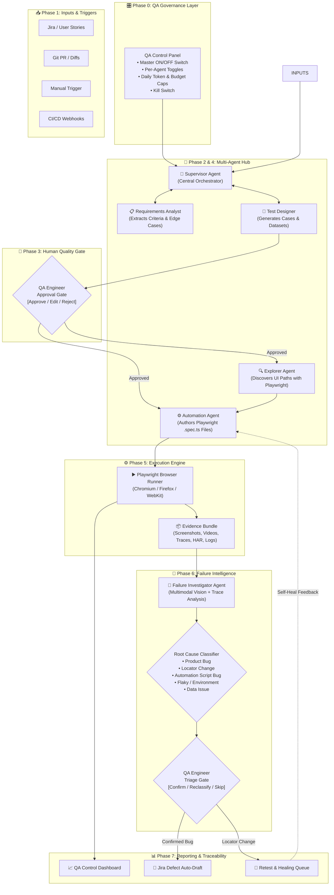

<div align="center">

# 🛡️ QA Sentinel
### AI-Powered Quality Governance & Test Lifecycle Orchestration

[](LICENSE)
[](https://playwright.dev/)
[](#system-architecture)
[](#human-governance--onoff-controls)
[](#roadmap)

**QA Sentinel** is an open-source, AI-powered quality governance platform designed to assist QA engineers throughout the entire testing lifecycle.

*It does not replace the QA engineer.*  
Instead, it automates repetitive toil—parsing requirements, authoring boilerplate Playwright scripts, inspecting failure traces, and formatting defect reports—while keeping the QA team in full command with strict human review gates and hard on/off controls.

[Key Features](#key-features) • [System Architecture](#system-architecture) • [Agent Roster](#specialized-ai-agents) • [QA Governance & On/Off](#human-governance--onoff-controls) • [Token Consumption](#ai-token-consumption-profile) • [Roadmap](#roadmap)

---

</div>

## 📌 The Problem It Solves

Modern software teams release faster than ever, but QA teams face compounding friction:
1. **Fragmented Workflows:** Acceptance criteria live in Jira, automation scripts in Git, screenshots in Slack, execution logs in CI/CD, and reports in spreadsheets.
2. **Repetitive Toil:** Engineers spend 60%+ of their time manually transcribing user stories into test cases, writing repetitive selector boilerplate, and triaging false-alarm test failures.
3. **Flaky & Opaque Failures:** A failed automated test does not mean the application is broken. Triaging whether a failure is a product bug, a changed DOM selector, a test data mismatch, or an environment timeout takes hours.
4. **Autonomous AI Risk:** Many recent "autonomous test agents" run unconstrained in the background, consuming thousands of dollars in LLM API tokens without human oversight or deterministic reproducibility.

---

## 💡 The QA Sentinel Approach

QA Sentinel re-architects QA around three core pillars:

1. **Multi-Agent Specialization:** Rather than one monolithic AI trying to do everything, a central **Supervisor Agent** coordinates purpose-built micro-agents (Requirements Analyst, Test Designer, Explorer, Automation Generator, Failure Investigator).
2. **Deterministic Browser Execution:** All tests run strictly through **Playwright**. AI plans, generates, and analyzes; standard, reliable browser binaries execute.
3. **Strict Human Governance:** Every AI recommendation passes through an interactive QA review gate. The platform operates strictly **on-demand** with master on/off switches and token spending caps. Zero background drift, zero unexpected costs.

---

## 🏛️ System Architecture



---

## 🤖 Specialized AI Agents

Each agent has a single, isolated domain of responsibility and speaks strictly structured JSON with the Supervisor:

| Agent | Responsibility | Core Tools | AI Usage |
|---|---|---|:---:|
| **🎯 Supervisor** | Workflow planning, state machine transitions, agent delegation, result aggregation. | State Graph, Policy Engine | ⚡ Medium |
| **📋 Requirements Analyst** | Deconstructs user stories, highlights missing boundary cases, extracts testable criteria. | LLM NLP, Jira API | 🔥 High |
| **🧪 Test Designer** | Structures positive, negative, and boundary scenarios; generates synthetic mock data. | LLM Prompt Chains | 🔥 High |
| **🔍 Explorer** | Crawls target staging applications using headless browsers to map DOM hierarchies. | Playwright, Accessibility Tree | ⚡ Medium |
| **⚙️ Automation** | Generates standard, typed TypeScript Playwright scripts (`.spec.ts`) and Page Objects. | Code Synthesizer, AST Validator | 🔥 High |
| **🔎 Failure Investigator** | Inspects Playwright `.zip` traces, failure screenshots, and console logs to deduce root cause. | Multimodal Vision LLM, HAR Parser | 🔥 High |

---

## 🎛️ Human Governance & On/Off Controls

A central principle of QA Sentinel is **Zero Uncontrolled Autonomy**.

```
   [ IDLE STATE ]  ──────>  [ ON-DEMAND RUN ]  ──────>  [ AUTO-TERMINATE ]
  • Agents are OFF           • QA Engineer triggers      • Task completed
  • 0 Token Consumption      • Budget limit enforced     • Agents shut down
  • $0 Cost                  • Human gates pause flow    • Return to IDLE (0 cost)
```

### Governance Capabilities:
- **🔴 Master Kill Switch:** Instantly aborts any active browser sessions and cuts LLM API streams with one click.
- **🔀 Modular Agent Toggles:** Disable specific agents (e.g., turn off *Automation Agent* to only use QA Sentinel for manual test design and failure triage).
- **💰 Hard Budget Guardrails:** Define daily or per-run token thresholds (e.g., maximum \$10/day or 500k tokens). Execution automatically freezes before budget overruns.
- **🛡️ Mandatory Human-in-the-Loop:** 
  1. No automated test script runs against staging without human sign-off on the test design.
  2. No defect report is filed to the engineering backlog without human verification of the failure classification.

---

## 📊 AI Token Consumption Profile

To maintain predictability and avoid black-box cloud bills, consumption is clearly compartmentalized:

| Stage | Activity | Tokens / Run | Cost Profile |
|---|---|:---:|:---:|
| **Governance & Toggles** | Config and safety checks | 0 | Free |
| **Input Ingestion** | Reading Jira / Git diffs | 0 | Free |
| **Requirements Parsing** | Criterion extraction & edge cases | ~2k – 8k | Minimal |
| **Test Design** | Step-by-step case generation | ~8k – 25k | Moderate |
| **Human Review Gates** | UI inspection and approvals | 0 | Free |
| **DOM Exploration** | DOM tree interpretation | ~5k – 15k | Low |
| **Script Generation** | Authoring Playwright `.spec.ts` | ~15k – 40k | Moderate |
| **Test Execution** | Running browser tests | 0 | Free (Local compute) |
| **Failure Analysis** | Vision inspection of screenshots + trace logs | ~20k – 60k | Only on failure |
| **Dashboard Metrics** | Metric aggregation and charting | 0 | Free (Computed code) |

---

## 🛠️ Technology Stack

- **Orchestration & Backend:** TypeScript / Node.js / Python FastEngine
- **Automation Framework:** [Playwright](https://playwright.dev/) (Chromium, Firefox, WebKit)
- **AI / LLM Interfacing:** OpenAI GPT-4o / Claude 3.5 Sonnet / Local Ollama (configurable per agent)
- **Frontend & Dashboard:** React, Tailwind CSS, shadcn/ui
- **Evidence Storage:** Local filesystem / S3-compatible object storage (Screenshots, Playwright Traces, Video)
- **Database:** PostgreSQL (with `pgvector` for test deduplication and historical matching)

---

## 🗺️ Project Roadmap

- [x] **Phase 1: Conceptualization & Architecture**
  - [x] Multi-agent supervisor pattern design
  - [x] End-to-end failure taxonomy classification
  - [x] Interactive visual architecture flowchart
- [ ] **Phase 2: Core Engine Prototype**
  - [ ] Standalone Playwright Evidence Collector
  - [ ] Failure Investigator multimodal trace analyzer
  - [ ] CLI runner with master ON/OFF flag
- [ ] **Phase 3: Agent Orchestration**
  - [ ] Requirements Analyst Jira connector
  - [ ] Test Designer with human approval CLI
  - [ ] Self-healing selector module
- [ ] **Phase 4: Unified Control Center**
  - [ ] React-based QA Control Dashboard
  - [ ] Real-time token burn monitor & budget limiter
  - [ ] Native GitHub Actions & GitLab CI integrations

---

## 🤝 Contributing

We welcome contributions from QA engineers, test automation developers, and AI researchers!  
Please read our [Contributing Guide](CONTRIBUTING.md) to get started.

---

## 📄 License

QA Sentinel is licensed under the [MIT License](LICENSE).
